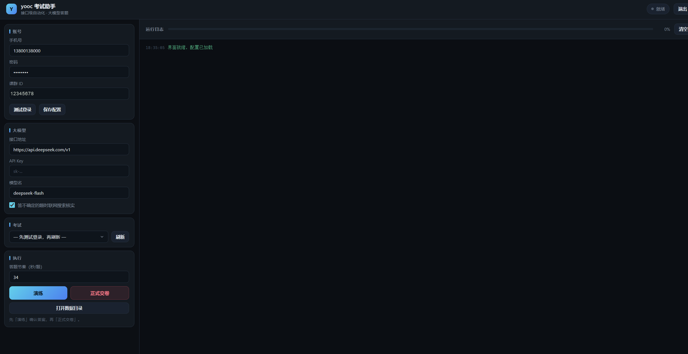

# yibanexam

易班优课（`exam.yooc.me`）考试自动化工具：登录 → 获取考试 → 本地题库 / 大模型答题 → 搜索核实 → 自动交卷。提供原生桌面界面（tkinter）和命令行两种用法。

[](https://github.com/miaoliwen/yibanexam/actions/workflows/tests.yml)
[](LICENSE)




> **免责声明**：本项目为非官方个人项目，与易班、优课及 DeepSeek 官方无关。请遵守所在学校的考试纪律和平台服务条款，仅在你有权使用的场景中使用。仓库内题库仅作功能演示，相关内容的权利归原权利人所有。

## 功能

- 账号密码登录，失败时可回退真实浏览器登录
- 多账号隔离：每个账号独立的登录态、断点、浏览器 profile
- 本地题库优先命中，支持从答案 TXT 一键生成题库
- 接入 DeepSeek / OpenAI 兼容接口答题，可选联网搜索核实
- 专项知识模块：把题目绑定到学校规章制度原文后重判
- 断点续跑、单次机会保护、交卷前人工核验
- 原生 tkinter GUI、浏览器 GUI、CLI 三种入口

## 环境

- Windows 10 / 11（主要开发和测试平台）
- Python 3.11+；原生界面需要带 tcl/tk 的官方 Python
- Chrome 或 Edge（浏览器通道可选）
- DeepSeek API Key（正式交卷必填；只做只读预检时可不填）

## 安装

```bash
git clone https://github.com/miaoliwen/yibanexam.git
cd yibanexam

python -m venv .venv
.venv\Scripts\activate

pip install -r requirements.txt
patchright install chromium    # 可选；本机已装 Chrome 时通常不需要
copy config.example.yaml config.yaml
```

## 配置

打开 `config.yaml`，至少填写：

```yaml
account:
  group_id: 12345678      # 考试页 URL /group/<groupId>/exams 里的数字
  username: "你的手机号"
  password: "你的密码"

llm:
  api_key: "sk-..."       # 正式交卷必填；DeepSeek 控制台申请
```

几个常用开关：

- `exam.dry_run`：默认 `true`。在没有作答记录时只做只读预检（登录、考试列表、设置），不会开考。
- `exam.allow_start_in_dry_run`：改为 `true` 才会真的“开考 → 答题 → 不提交”，会消耗一次作答机会。
- `exam.auto_submit`：答完后是否自动交卷。
- `bank.mode`：默认 `staged`，题库定答 → 模型校验 → 搜索核实 → 人工核验。
- `llm.search_enabled`：是否在低置信题目上联网核实。

完整字段和注释见 [config.example.yaml](config.example.yaml)。

> 这类考试通常机会有限。第一次使用请保持 `dry_run: true`，确认流程后再进行真实操作。

## 运行

### 原生桌面版（推荐）

```bash
python gui_tk.py
```

Windows 上也可以双击 `run-tk.bat`，脚本会自动寻找带 tkinter 的 Python。

### 浏览器版

```bash
python gui.py
```

或双击 `run.bat`。程序会启动本地页面，地址里带一次性令牌，关闭页面后自动退出。

### 命令行

```bash
python main.py --login-only     # 只验证登录
python main.py --status         # 查看本地断点，不联网
python main.py                  # 只读预检（默认 dry_run）
python main.py --start-dry-run  # 真正开考并答题，但不交卷（消耗一次机会）
python main.py --start-only     # 开考并答题，停在交卷前
python main.py --live           # 续跑并正式交卷
python main.py --exam-id 123456 # 指定考试
python main.py --build-bank 答案.txt --bank-name 入学教育
```

更多参数：`python main.py --help`。

## 题库

仓库自带一份 50 题的示例题库 `data/question_bank.json`（南通师范高等专科学校入学教育），用于演示题库命中、选项乱序映射和改判流程。

- 不需要时：把 `bank.enabled` 改为 `false`，或删除该文件。
- 想换成自己的题库：准备题干 + 选项 + 答案字母的 TXT，然后运行 `python main.py --build-bank 答案.txt --bank-name 我的题库`。
- 题库命中按选项文本映射，不依赖线上选项顺序。

题库和试卷内容的权利归原权利人所有；如权利人提出要求，会移除相关内容。

## 项目结构

```text
yibanexam/
├─ assets/               # 浏览器版页面与截图
├─ data/
│  └─ question_bank.json # 示例题库
├─ src/                  # 登录、答题、搜索、题库、状态机等核心逻辑
├─ tests/                # 离线单元测试
├─ tools/                # 辅助脚本
├─ gui.py                # 浏览器 GUI
├─ gui_tk.py             # tkinter GUI
├─ main.py               # CLI
├─ config.example.yaml   # 配置模板
├─ requirements.txt
├─ gui.spec / guitk.spec / cli.spec
└─ run.bat / run-tk.bat
```

## 打包 exe

```bash
pip install pyinstaller

# 单文件桌面版
pyinstaller guitk.spec --noconfirm --clean

# 文件夹模式（启动更快，杀软误报更少）
set YOOC_ONEFILE=0
pyinstaller guitk.spec --noconfirm --clean

# 浏览器版 / CLI
pyinstaller gui.spec --noconfirm --clean
pyinstaller cli.spec --noconfirm --clean
```

打包产物在 `dist/`，不要提交到仓库。也可以直接下载 [Releases](https://github.com/miaoliwen/yibanexam/releases) 中的 Windows 版本。

## 数据与隐私

程序运行后会在 `data/profiles/<账号键>/` 下生成：

- `browser_profile/`：Chrome 用户目录（Cookie、本地存储）
- `session.json`：登录凭据与 Cookie
- `exam_state.json`：断点状态
- `run.log`：运行日志

这些文件包含登录态和考试记录，**不要分享或提交**。`.gitignore` 已排除 `data/` 下的运行数据、`config.yaml`、`dist/`、`build/` 和缓存。

`config.yaml` 中的密码和 API Key 是明文存储；请勿把填好的配置发给他人。如果曾经泄露，请立即修改密码并轮换 API Key。

## 测试

```bash
python -m unittest discover -s tests -t . -v
```

测试全部离线运行，不需要账号或网络。

## 许可证

[MIT](LICENSE)
